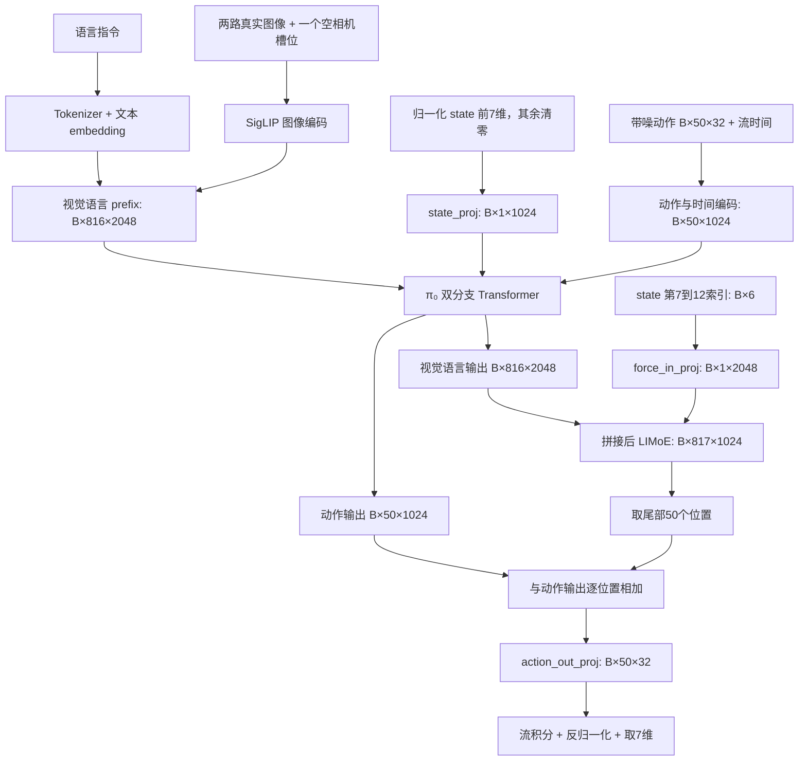

# ForceVLA 代码分析：输入输出、力觉融合、方向盘插入与 π₀.₅ 迁移

分析日期：2026-10-02。仓库基准：`79de88fdd0651d957a2b5212cae8995159c5ad65`。

本文以本地代码的实际执行路径为准。任务已确认是“机械臂持方向盘，将其装到转向柱/花键轴上”；机器人型号、传感器、控制接口、装配公差和现有数据尚未提供。任务部分因此是实施建议，不是已经验证的控制参数。

分析采用源码检查、张量形状推导和独立函数检查。当前终端的 Python 3 环境缺少 JAX/Flax，未运行完整模型训练、checkpoint 加载或机器人实验。本文只新增分析文档，没有修改模型实现。

## 1. 先回答核心问题

1. **现有 ForceVLA = π₀ 主体 + 一个后置的力觉融合分支。** 图像、语言、机器人状态和带噪动作先经过 π₀；6 维力/力矩单独投影成一个连续 token，与 π₀ 的视觉语言输出共同进入 LIMoE，最后以残差方式影响动作预测。
2. **force token 的默认形状是 `[B, 1, 2048]`。** 六个通道一起生成一个 token，不是六个 token，不是词表 ID，也不是未来目标力。后续 LIMoE 输出是 `[B, 817, 1024]`，其中尾部 50 个位置被用作动作特征的修正量。
3. **force 会改变融合分支中的视觉语言表示和最终动作，但不会在同一次前向中改变 π₀ 主干已经计算好的视觉语言特征。** 训练时，动作损失可以沿融合分支向未冻结的上游参数反向传播。
4. **“独立于 π₀”主要指可单独实现的力编码、LIMoE、数据适配和机器人控制层。** 当前分支仍依赖 π₀ 的特征维度与输出接口，不能脱离动作模型直接完成控制。
5. **当前代码有部署阻塞项。** 推理把 `None` 当作视觉语言特征拼接；MoE 默认序列长度下不支持 batch=1 的现有分组/reshape；融合层没有延续 padding mask；尾部 token 与未来动作没有显式对齐。见第 8 节。
6. **方向盘插入应先建立力觉闭环与数据协议，再比较模型。** 建议先修通 π₀+force 基线，再在受支持的上游 π₀.₅ 实现上迁移 force 分支；仅更换 checkpoint 路径不成立。

## 2. 仓库地图：各部分负责什么

以下链接相对于本文件；表中的函数名便于在编辑器中定位。

| 部分 | 入口文件 / 符号 | 输入 | 输出 / 下游 |
|---|---|---|---|
| 实验配置 | [training/config.py](../src/openpi/training/config.py)，`forcevla_lora`、`LeRobotForcevlaDataConfig` | 配置名、数据集 ID、权重路径 | 模型配置、数据变换、训练参数 |
| 数据读取 | [training/data_loader.py](../src/openpi/training/data_loader.py)，`create_torch_dataset` | LeRobot 数据集、FPS、动作 horizon | 当前观测 + 从当前时刻开始的动作 chunk |
| 机器人数据适配 | [policies/forcevla_policy.py](../src/openpi/policies/forcevla_policy.py) | 两张图像、state、prompt、可选 actions | 三个相机槽位及 mask，补齐到 32 维的 state/actions |
| 通用变换 | [transforms.py](../src/openpi/transforms.py) | 原始字段、统计量 | 字段重排、相对动作、归一化、图像缩放、文本 token |
| 观测结构 | [models/model.py](../src/openpi/models/model.py)，`Observation` | 变换后的字典 | 模型统一输入；图像转为 `[-1,1]` |
| 图像编码 | [models/siglip.py](../src/openpi/models/siglip.py) | `[B,224,224,3]` 图像 | 每相机 `[B,256,2048]` 连续图像 token |
| 文本编码 | [models/tokenizer.py](../src/openpi/models/tokenizer.py) + [models/gemma.py](../src/openpi/models/gemma.py) | 指令字符串 → token ID | `[B,48]` ID/mask → `[B,48,2048]` embedding |
| π₀ 基线 | [models/pi0.py](../src/openpi/models/pi0.py) | 图像、文本、state、带噪动作与流时间 | 训练损失或连续动作 chunk |
| ForceVLA 模型 | [models/pi0_force.py](../src/openpi/models/pi0_force.py)，`Pi0_Guidance` | 上述输入 + state 中的六维力觉 | 带力觉条件的流场预测及动作采样 |
| 力觉融合 | [models/limoe_simple.py](../src/openpi/models/limoe_simple.py)，`LIMoEBlock` | `[视觉语言特征; force token]` | 自注意力 + 稀疏专家处理后的特征 |
| MoE 底层 | [flaxformer routing.py](../flaxformer/flaxformer/architectures/moe/routing.py)、[dense.py](../flaxformer/flaxformer/components/dense.py) | token、路由权重、容量 | 专家分配、MLP 输出与路由指标 |
| 权重初始化 | [training/weight_loaders.py](../src/openpi/training/weight_loaders.py)，`Pi0GuidanceWeightLoader` | π₀ checkpoint + 新模型参数树 | 复用 π₀ 权重，保留新增 force/LIMoE/LoRA 的初始化 |
| 训练 | [scripts/train.py](../scripts/train.py) | 模型、训练 batch、优化器 | 更新后的参数、日志、checkpoint |
| 统计量与保存 | [compute_norm_stats.py](../scripts/compute_norm_stats.py)、[checkpoints.py](../src/openpi/training/checkpoints.py) | 经机器人适配和 delta 变换的数据 | state/actions 统计量，以及带 assets 的 checkpoint |
| 推理包装 | [policy_config.py](../src/openpi/policies/policy_config.py)、[policy.py](../src/openpi/policies/policy.py) | 实时观测、checkpoint | 反归一化后的 `[H,7]` actions 和推理时间 |
| 网络服务 / 执行 | [serve_policy.py](../scripts/serve_policy.py)、[action_chunk_broker.py](../packages/openpi-client/src/openpi_client/action_chunk_broker.py) | 观测请求、预测 chunk | WebSocket 返回值、逐步发出的动作 |

`pi0_fast.py` 是另一条基于离散动作 token 的路线，当前 `forcevla_lora` 不走它。`vit.py` 和 `utils/fsq_tokenizer.py` 也不是本配置的 force 编码路径。仓库里的 ALOHA、DROID、LIBERO 示例展示数据/运行接口，不等于已经实现方向盘装配控制。

## 3. 从数据到机器人输出：如何串起来

### 3.1 当前训练配置

`training/config.py` 的 `forcevla_lora` 当前设置：

| 配置 | 实际值 |
|---|---|
| 模型 | `Pi0_GuidanceConfig` |
| VLM / 动作专家 | `gemma_2b_lora` / `gemma_300m_lora` |
| 模型动作维度 `D` | 32 |
| 动作长度 `H` | 50 |
| 文本长度 `L` | 48，包含 padding |
| 数据集 ID | `flexiv_peel_cucumber_inputForce` |
| 初始化权重 | `gs://openpi-assets/checkpoints/pi0_base/params` |
| 训练步数 / batch | 50,000 / 4；README 示例另外把 batch 覆盖为 32 |
| 语言来源 | `prompt_from_task=True`，从 LeRobot task 元数据生成 |

这里的数据集名字不是方向盘任务。模型输入的每个数值具体使用什么物理单位、坐标系，以及数据集实际字段是否符合注释，仍需查看真实样本；源码没有提供这些物理约定的完整定义。

### 3.2 原始数据协议

训练 repack 后、推理调用前应提供：

```text
image:       [height, width, 3]，外部相机
wrist_image: [height, width, 3]，腕部相机
state:       [13]，按当前模型切片约定
prompt:      字符串
actions:     [H,7]，仅训练提供
```

训练时映射关系：`observation.image → image`、`observation.wrist_image → wrist_image`、`observation.state → state`、`action → actions`。LeRobot 的点号字段名在这里是实际键名，不能随意改成其他嵌套结构而不调整 repack。

**按模型执行代码，state 的布局应为：**

```text
索引  0  1  2   3     4      5     6        7   8   9   10   11   12
      x  y  z  roll  pitch  yaw  gripper   Fx  Fy  Fz   Tx   Ty   Tz
      └──── 机器人本体状态 7 维 ────┘     └──── wrench 6 维 ────┘
```

最后六维可按 `[Fx,Fy,Fz,Tx,Ty,Tz]` 建立新任务协议，但源码只按索引读取，不能证明原数据采用了这个单位/顺序。需要与采集端核对。

`make_forcevla_example()` 却构造了 14 维，并注释为“7 维位姿 + 1 维夹爪 + 6 维力”。若实际是四元数位姿，这与上述 13 维 RPY 布局不兼容，不能直接喂入。

### 3.3 训练数据处理顺序

```text
LeRobot 当前帧 + action[t:t+H]
  → 根据 task_index 得到 prompt
  → RepackTransform 字段重排
  → Forcevla_inputs：图像格式转换，state/actions 补零到 32 维
  → DeltaActions：前 6 个动作维度减去当前 state 的前 6 维
  → Normalize：state/actions 按训练统计量归一化
  → ResizeImages(224,224) + TokenizePrompt(48)
  → batch + Observation.from_dict
  → compute_loss
  → 梯度更新 + checkpoint
```

注意以下实际行为：

- 模型看到的是一个时刻的 state/force，而不是 force 历史。`delta_timestamps` 当前只为 action 序列配置未来采样，间隔为 `1 / dataset_meta.fps`。
- `DeltaActions` **已经启用**。对于 chunk 中每一步，都是减同一个当前状态 `s_t`，不是相邻动作差分 `a[t+k]-a[t+k-1]`。第 7 维夹爪不做差分。
- 如果原始标签本来就是增量，就必须取消或重写 delta 变换，否则会重复相减。
- 默认 `DataConfig.use_quantile_norm=False`，本配置使用 `(x-mean)/(std+1e-6)`。force 与 proprio 同在 state 中，各维分别统计；force 不是以原始牛顿值直接输入线性层。
- RPY 在这里只做数值相减，没有角度 wrap 或 SO(3) 运算。角度跨越 ±π 时会产生错误的大增量。
- 空缺的右腕相机仍占 256 个 token，π₀ 主干用 mask 屏蔽它，不会从张量中删除。

### 3.4 推理的逆向处理

`create_trained_policy` 从 checkpoint 的 assets 加载训练时统计量，保证输入输出尺度一致：

```text
实时两路图像 + state(含 force) + prompt
  → Forcevla_inputs → Normalize → resize/tokenize → 增加 batch 维
  → sample_actions → [1,50,32]
  → 去除 batch 维 → Unnormalize
  → AbsoluteActions：前 6 维加回当前状态
  → Forcevla_outputs：取前 7 维
  → {actions: [50,7], policy_timing: ...}
```

`Group.push` 会把新增输出变换放在已有输出变换之前，因此实际是先 `AbsoluteActions`，后裁剪到 7 维。按当前配置对绝对动作数据的假定，服务最终返回绝对目标位姿和夹爪值；它们不是默认的机器人关节力矩或目标接触力。

客户端仍需将这些目标转换为机器人支持的控制接口，包括坐标变换、插补和终止条件。这一部分没有在 ForceVLA 模型中实现。

## 4. 模型内部的输入输出与 token 形状

约定 `B=batch`，`H=50`，`D=32`，VLM 宽度 `d_v=2048`，动作专家宽度 `d_a=1024`。以下数字对应当前默认配置。



此图描述训练路径和推理应实现的计算关系；第 8 节记录了当前采样代码未正确实现的地方。

### 4.1 图像和语言：prefix

`embed_prefix()` 对每个相机调用 SigLIP。224×224 图像按 14×14 patch 划分，得到 `16×16=256` 个 token，再投影到 2048 维。语言先转词表 ID，再查 embedding。

| 张量 | 形状 | 含义 |
|---|---|---|
| 单相机图像 token | `[B,256,2048]` | 连续 patch 特征 |
| 三相机合并 | `[B,768,2048]` | 含被 mask 的空相机 |
| 文本 ID / mask | `[B,48]` | 离散 ID，实际文本可能短于 48 |
| 文本 embedding | `[B,48,2048]` | 连续文本表示 |
| `prefix_tokens` | `[B,816,2048]` | 图像后接文本 |
| `prefix_mask` | `[B,816]` | 标识有效图像和文本 token |

### 4.2 本体状态与带噪动作：suffix

`embed_suffix()` 先创建全零的 `[B,32]`，仅复制归一化 `obs.state[:, :7]`。这样 force 不会经 `state_proj` 直接进入动作专家。这个 32 维向量被投影成一个 `[B,1,1024]` state token。

动作分支输入是带噪动作 `x_t:[B,50,32]`，经 `action_in_proj` 得到 `[B,50,1024]`。标量流时间 `t` 编码为 1024 维并重复 50 次，与动作特征拼接为 2048 维，再经两层 MLP 回到 1024 维。

最终 `suffix_tokens:[B,51,1024]`，序列为 `[state token, action_0, ..., action_49]`。这里的 `t` 是流匹配采样时间，不是传感器时间戳。

### 4.3 π₀ 主干怎样融合视觉、语言和动作

`gemma.py` 为视觉语言流和动作流维护不同的参数及隐藏宽度，但将它们投影到兼容的注意力 head 空间，共同进行受 mask 控制的注意力计算。

| 查询 token | 可读取视觉/语言 | 可读取 state | 可读取整个动作 chunk |
|---|---|---|---|
| 图像/语言 prefix | 是，有效 prefix 内双向 | 否 | 否 |
| state token | 是 | 是 | 否 |
| action tokens | 是 | 是 | 是，动作块内双向 |

所以这里不是“先输出一段文字，再把文字交给控制器”。动作专家每层直接读取视觉语言的注意力信息。

### 4.4 模型输出为何不是直接的动作 token ID

训练目标采用 flow matching。设归一化示教动作为 `a`，高斯噪声为 `ε`：

```text
x_t = t ε + (1-t) a
u_t = ε - a
v_t = action_out_proj(action_hidden + force_fusion_hidden)
loss[B,H] = mean_over_32_dims((v_t-u_t)^2)
```

训练脚本继续对 batch 和 horizon 求平均。**`v_t` 是动作张量在流时间中的变化率，不是物理末端速度。** `sample_actions()` 默认从噪声出发执行 10 次 Euler 更新 `x ← x + dt*v_t`，`dt=-1/10`，最终得到连续动作 chunk。

补齐的 25 个动作维度也进入当前均方损失；没有仅对前 7 维计算损失的 action mask。迁移或改变动作表示时应核对这一点，但不能直接把 `action_dim` 改成 7 而期待原 checkpoint 的投影层形状仍兼容。

## 5. force 分支具体是怎么构建的

### 5.1 六维 wrench → 一个连续 token

核心代码位于 `pi0_force.py` 的构造函数和 `embed_suffix()`：

```python
self.force_in_proj = nnx.Linear(6, paligemma_config.width, rngs=rngs)
force_tokens = self.force_in_proj(obs.state[:, 7:13])[:, None, :]
```

数学形式是 `z_f = f_norm @ W_f + b_f`，其中 `W_f:[6,2048]`、`b_f:[2048]`，共 14,336 个参数。`[:,None,:]` 增加 token 轴：`[B,2048] → [B,1,2048]`。

一个样本的实际结构类似：

```text
归一化输入： [f_x, f_y, f_z, τ_x, τ_y, τ_z]  # 6 个连续数
force token：[[z_0, z_1, ..., z_2047]]       # 1 个 token，2048 个连续数
```

各个 `z_i` 是学习得到的组合，没有“第 0 维仍表示 Fx”的固定含义。它没有离散量化、codebook、力觉 tokenizer 或未来力预测头。单独这一步也没有时间窗口、力变化率、FFT 或接触事件编码。

传感器去偏、重力补偿、坐标变换、滤波和时间同步均没有在这条模型路径中实现。它接收的是采集/适配层已经准备好的六个数。

### 5.2 force token → LIMoE

训练中执行：

```python
fusion_input = concatenate([prefix_out, force_tokens], axis=1)
fusion_output, _ = self.limoe(fusion_input)
```

拼接输入是 `[B,817,2048]`。LIMoE 的内部顺序是：

```text
输入
 → LayerNorm → 8-head self-attention → residual
 → LayerNorm → Dense(2048) → GELU → Dense(2048) → residual
 → router：每个 token 选择 4 个专家中的 top-1
 → 对应专家 MLP → 与专家输入做 residual
 → Dense(1024)
 → 返回 (features, None)
```

专家本身使用 Flaxformer `dense.MlpBlock`，不是前面的 GELU MLP：本地默认中间宽度 2048、激活 ReLU。`mlp_dim` 在这里主要传给注意力后面的普通 MLP；不要把所有子层都误认为同一个“专家层”。

四个专家没有被预先指定为“视觉专家、语言专家、力专家、动作专家”。路由器对已经混合过模态的每个 token 学习专家分配。top-1 表示每个 token 至多分配给一个专家；容量限制仍可能让 token 丢失专家处理机会，残差路径保留其原表示。

### 5.3 它输出的究竟是哪一种 token

需要区分三层输出：

| 位置 | 形状 | 语义 |
|---|---|---|
| `force_in_proj` 后 | `[B,1,2048]` | 当前力觉的连续 embedding |
| `LIMoEBlock` 后 | `[B,817,1024]` | 视觉、语言与力共同参与计算的特征序列 |
| 与动作特征相加后、输出投影后 | `[B,50,32]` | 流匹配向量场；采样完成才成为连续动作 |

因此，**force 分支没有生成一串可以发送给机械臂的“力 token 指令”。** 对机器人可执行的输出仍是位姿/夹爪动作。

## 6. 多模态怎样互相影响

### 6.1 前向影响：后置注意力先混合，专家再处理

在 LIMoE 自注意力中，简化写作：

```text
X = [visual_language_features; force_token]
Q = LN(X)Wq, K = LN(X)Wk, V = LN(X)Wv
Y = X + softmax(QKᵀ / √d)V
```

力 token 既是 query，也提供 key/value。因此视觉或语言位置的融合输出可以读取力信息，力位置也可以读取图像和语言。随后路由器根据融合后的 token 内容选专家，force 可以间接改变其他 token 的专家选择。

这种机制让模型有机会学习“同样看起来已对准，但侧向受力不同，下一步应该向不同方向微调”。是否真的学会，需要成对观测与消融实验验证；代码中存在注意力连接不等于已经有可靠的装配能力。

### 6.2 影响动作：直接加到动作 hidden 上

实际代码：

```python
correction = limoe_out[0][:, -self.action_horizon:]
action_hidden = suffix_out[:, -self.action_horizon:]
v_t = self.action_out_proj(correction + action_hidden)
```

`limoe_out[0]` 是取 tuple 的特征张量，不是取 batch 第一个样本。修正量和动作特征都是 `[B,50,1024]`。

没有显式门控、力控制目标或接触状态机。由于 `action_out_proj` 是线性层，可把该设计看成对基础流场增加一个由视觉、语言和当前力共同决定的残差项。

对固定观测，这个后置分支本身不读取带噪动作或流时间，也不读取本体 state token；在当前 π₀ 结构下它的修正特征在 10 次积分中相同，整个向量场仍因动作专家而依赖 `x_t,t`。

### 6.3 哪些模态实际上没有被 force 改变

| 对象 | 同一次前向中是否被 force 改变 | 原因 |
|---|---|---|
| 输入图片、文字、机器人传感器值 | 否 | 它们是输入 |
| SigLIP 图像 token | 否 | force 不进入 SigLIP |
| π₀ 主干的 `prefix_out` 与 prefix KV cache | 否 | force 在主干之后才加入 |
| π₀ 主干的 `suffix_out` | 否 | state token 已排除 force，也没有 force prefix |
| LIMoE 内的视觉/语言/force 特征 | 是，可以 | 共同参加 self-attention |
| 最终预测动作 | 是，可以 | 修正项进入输出投影与流积分 |
| 下一次观测的图像与 wrench | 可以间接改变 | 执行动作改变了真实物理状态 |

训练时另有反向路径：`动作损失 → 输出投影 → LIMoE → force_in_proj / prefix_out`。没有 `stop_gradient` 阻断 prefix 分支，因此力条件任务可以推动上游可训练参数适配。

### 6.4 “LoRA 配置”并不表示其他所有参数都冻结

`get_freeze_filter()` 在当前双 LoRA 配置中冻结匹配 `.*llm.*` 且不是 LoRA 的参数。因此：

- LLM 主权重冻结，LLM 内 LoRA 可训练；动作专家也有 LoRA。
- `force_in_proj`、`limoe`、state/action 投影以及时间 MLP 不匹配该冻结规则，可训练。
- `PaliGemma.img` 也不匹配 `llm`，**图像编码器没有被这个过滤器冻结**。
- 对图像模块调用 `train=False` 控制训练行为（如 dropout），不等于冻结梯度。

这会影响显存、训练成本和“力觉梯度能否影响视觉编码器”的判断。新增任务若要只训练 adapter/LoRA，需要另行明确冻结规则并打印可训练参数清单。

## 7. 哪些部分独立于 π₀，迁移时能保留什么

| 部分 | 独立程度 | 迁移时的处理 |
|---|---|---|
| 传感器标定、坐标系、同步、重力补偿 | 与模型无关；当前模型代码未实现 | 建成采集/控制基础设施，可跨模型复用 |
| LeRobot 数据、相机和动作协议 | 概念可复用 | 键名、维度、归一化顺序要适配新框架 |
| `force_in_proj` | 思路独立，输出宽度耦合 VLM | 可复用或改为 MLP/时序编码器 |
| `LIMoEBlock` | 独立的 Flax 模块 | 与 Flaxformer/JAX 版本、mask、分组规则和宽度有关 |
| 融合到动作的残差接口 | 紧耦合当前实现 | 需要适配动作 hidden 和 horizon，建议重设计对齐 |
| flow matching 动作生成、Gemma、SigLIP | π₀ 基础结构 | π₀.₅ 迁移时优先使用上游实现 |
| `Pi0GuidanceWeightLoader` | 耦合参数路径 | 重写/核对缺失参数规则及 shape 检查 |
| WebSocket 通信、日志、chunk 调度 | 大部分与模型无关 | 保留协议，验证控制频率与延迟 |
| 导纳/阻抗控制、装配判定 | 与 VLA 可分离；本仓库没有 ForceVLA 专用实现 | 在机器人端单独实现和验证 |

ForceVLA 继承的是 `BaseModel`，`pi0_force.py` 复制了较多 π₀ 逻辑，并非给 `Pi0` 挂一个通用插件。这也是后续迁移容易出现训练/推理逻辑分叉的原因。

## 8. 当前实现的问题与修复优先级

### 8.1 P0：采样中把 `None` 拼进 LIMoE

`pi0_force.py:309` 左右先计算 `prefix_out_fix` 并建立 KV cache。每个采样步随后只计算 suffix，明确断言 `prefix_out is None`，却仍执行：

```python
self.limoe(jnp.concatenate([prefix_out, force_tokens], axis=1))
```

这条路径无法正常完成数组拼接。最小修复是使用 `prefix_out_fix`。更合理的是把固定观测的 force 编码、LIMoE 与尾部提取移到积分循环外缓存；前提是继续保持这个分支不依赖 `x_t,t`，并解决下述 mask 和分组问题。

### 8.2 P0：默认长度下 batch=1 的 MoE reshape 不成立

`_num_groups()` 要求 groups 是专家数 4 的倍数，同时整除 token 总数。默认 LIMoE 序列长 817，单样本总 token 数不能被 4 整除。

对仓库原函数进行独立执行得到：

| Batch | token 总数 | 返回 groups | 每 group token | groups 可被 4 整除 |
|---|---:|---:|---:|---|
| 1 | 817 | 817 | 1 | 否 |
| 2 | 1634 | 1634 | 1 | 否 |
| 4 | 3268 | 3268 | 1 | 是 |
| 32 | 26144 | 3268 | 8 | 是 |

函数到达 `num_groups == num_tokens` 后没有再次验证专家整除条件，后面的 `_call_experts()` 用 `num_groups // num_experts` reshape 会失败。`Policy.infer()` 恰好生成 batch=1，所以即使修好 `None`，仍有下一处阻塞。

建议改为支持任意 batch/序列长度的路由分组：例如把**路由阶段** token 补齐到合适 group 大小，明确屏蔽补齐项并在恢复序列时移除；或者换成不依赖上述 all-to-all reshape 的实现。不能仅靠把 batch 改成 4 来解决真实单请求部署。batch=4 时 group 退化为单 token 也值得单独检查效率。

### 8.3 P1：融合层丢失了有效 token mask

π₀ 主干收到 `prefix_mask`，但 `LIMoEBlock/Encoder1DBlock` 没有传入对应 attention mask。右腕空图像和文本 padding 的输出不是保证为全零的特征，在 LIMoE 中会被当作可关注位置。

路由器的 `ignore_padding_tokens=True` 仅通过特征是否为零判断 padding，无法恢复上游的语义 mask。建议把 `concat(prefix_mask, force_valid_mask)` 贯穿注意力、路由、聚合和最终提取过程，必要时每个 residual 子层后重新清零无效位置。

### 8.4 P1：尾部 50 个位置不是 50 个未来动作 query

默认融合输入的 0-based 位置为：图像 `0..767`，文本 `768..815`，force `816`。`[-50:]` 实际取得：

```text
位置 767：最后一个图像位置（默认恰好属于空右腕相机）
位置 768..815：全部 48 个文本位置，含 padding
位置 816：force 位置
```

这些位置经过 attention 后已经有全局上下文，所以它不是单纯的“取原始文本”；但它们与未来第 0..49 步没有显式结构对应。改变文本长度、horizon 或相机排列会改变修正来源。

建议按实验复杂度逐步比较：

1. 有 mask 的全局池化 + 输出映射，先建立明确的简单基线。
2. `H` 个带时间步标识的 learned action queries 对融合特征做 cross-attention，得到 `[B,H,1024]`，固定观测时仍可缓存。
3. 直接用当前动作 hidden 作为 query，得到随采样步变化的 force 修正；这种方案需要在积分循环内计算。

这些都是拟议结构，当前仓库没有实现。

### 8.5 P1：state 布局、动作物理语义需要统一

14 维例子和 13 维硬编码矛盾，会造成 force 切片错位。建议在适配层检查实际 shape，定义具名的 proprio/wrench 字段，再显式拼接；如果用四元数或旋转 6D，连同 state/action 投影及输出变换一起修改。

此外没有单位、坐标系、传感器状态和时间戳校验。方向盘任务必须把这些协议写清，不能依赖注释猜测。

### 8.6 P2：训练和可观测性方面的缺口

| 发现 | 影响与建议 |
|---|---|
| LIMoE 默认 `deterministic=True`，调用未传 `train` | 按显式调用链，训练时也关闭该分支 dropout/jitter；应明确预期并在运行环境验证 |
| 路由 auxiliary loss / z-loss 只通过 `sow` 记录 | 训练目标只有动作 MSE，没有把这些正则加入；监测专家利用率、丢 token 比例、路由塌缩后再决定系数 |
| 力觉只有当前样本 | 无法显式表示冲击、趋势和接触滞后；可增补因果历史窗口 |
| 修正分支没有初始门控 | 随机初始化的分支会改变预训练输出；可用零初始化输出投影或可学习门控渐进接入 |
| `lazy_init` 硬编码 `[32,200,2048]` | 初始化可通过不代表真实 `[1,817,2048]` 推理可通过；必须覆盖部署形状 |
| 形状注解将 force 宽度写为 `2*emb` | 2048/1024 默认组合成立，其他模型宽度组合未必成立；迁移时显式区分两种宽度 |
| 缺少当前 ForceVLA 专用端到端测试 | `pi0_test.py` 不能替代 force 配置、实际 batch 和 checkpoint 的验证 |

建议修复验收至少包含：真实适配数据的一次 loss/梯度计算；batch=1 的采样；冻结参数清单；同一噪声下训练式全序列前向与 KV-cache 前向的 `v_t` 一致性；masked token 扰动不影响有效结果；只改 wrench 时动作输出/梯度是否响应；checkpoint 保存重载后结果一致。

## 9. 方向盘插入任务如何实施

### 9.1 把任务拆成能验证的阶段

建议先从“方向盘已被稳定抓持，移动到轴前预装配位姿”开始训练局部装配，再扩展取件和搬运。先明确花键是否有唯一角度、主键/定位标记，以及“插入完成”是否还包含紧固；本方案覆盖插入，不自动包含螺栓紧固。

| 阶段 | 主要观测 | 推荐动作和判据 |
|---|---|---|
| 接近与粗对准 | 外部/腕部视觉、末端位姿 | 对准轴线和目标角度，移动到预接触位置 |
| 低速探触 | 轴向力及其变化、进给位移 | 识别首次接触，切换到更短执行窗口 |
| 轴线与花键微调 | 横向力、倾覆力矩、轴向扭矩、视觉 | 小幅平移/倾角/绕轴旋转；范围由零件和工装确定 |
| 插入 | 插入深度、轴向/横向 wrench | 控制进给，遇阻回退并重新对准 |
| 到位判断 | 深度、姿态、到位传感器/工装信号、力变化 | 组合判据确认，不能只凭“轴向力升高”判断成功 |
| 失败恢复 | 超限、无进展、滑移或姿态偏差 | 停止进给、退回可恢复位置、重新观测 |

力升高可能意味着到位，也可能意味着歪斜卡住。只有当前六维力而没有运动历史/深度时，这两种情况可能很难区分。控制端保留阶段、进度与超时状态，即使先不把它们输入模型，也可用于判定和记录。

### 9.2 先建立力觉物理协议

推荐把 wrench 表达到以装配轴为 z 轴的任务坐标系，规定正负号和力矩参考点。需要记录/实现：

- 夹具和方向盘负载的零偏、重力与质心补偿，且在同一坐标系、同一参考点上处理。
- 传感器系到任务系的旋转；参考点变化还要做力矩平移，不能只旋转六个通道。
- 相机、机器人 state、wrench 和动作命令的统一时间基准，记录测量延迟。
- 使用截至观测时刻的因果滤波；记录断流、饱和和有效性状态。离线处理不能使用未来样本来构造当前力输入。

对坐标变换，可用 `F_T = R_TS F_S`，`τ_T = R_TS τ_S + p_TS × F_T`；这里 `p_TS` 明确定义为“任务原点指向传感器原点”的向量，并用任务系表达。应先用已知方向的小载荷验证符号，再用于示教。

建议原始记录使用 m、rad、N、N·m，并保留原始与补偿后的 wrench。模型输入可以归一化，但控制器阈值应在明确物理单位下判断。

### 9.3 模型策略与快速接触控制分开运行

建议的系统连接方式：

```text
相机 + state + wrench → VLA → 短期位姿目标
                                ↓
实时 wrench → 机器人导纳/阻抗或受限位姿跟踪 → 机器人
                                ↓
                      深度/到位/卡滞判定与下一次观测
```

ForceVLA 负责基于视觉、任务和接触状态选择调整动作；接触控制器负责机器人接口支持范围内的快速响应、速度限制和力限值。本仓库没有提供方向盘专用的这一控制器，需要结合具体机器人实现。

不要把 50 步预测一次性全部执行。`ActionChunkBroker` 在缓存耗尽前不会重新调用模型，因此中途采到的新 force 不会影响这批已缓存动作。应区分“预测长度 H”和“实际执行步数 K”，采用 `K ≪ H` 的重规划，并在接触事件时丢弃剩余缓存。

例如，若数据频率是 20 Hz，H=50 覆盖 2.5 秒；这只是时间换算，不能据此把接触阶段开环执行设成 2.5 秒。K、推理步数和控制周期应根据实测端到端延迟、运动速度与允许接触误差选择。若算力无法提供足够反馈频率，就让局部接触控制器承担更完整的搜索/插入过程。

目前输出的七维是位姿与夹爪，**没有目标力、刚度或阻尼输出**。第一版建议保持这个动作接口，接触控制器参数先固定；若后续让模型预测这些控制参数，需要扩展数据标签、输出头、归一化、约束和训练，不是改一个 prompt 即可。

### 9.4 数据应该怎样采集

每个时间点至少保存：两路 RGB、实际末端位姿、夹爪、原始/补偿 wrench、发给控制器的目标、实际运动、时间戳、任务阶段和最终成功标记。训练所用 action 应有一致含义，推荐先采用当前代码易兼容的绝对目标位姿 + 夹爪；不要混用位置目标、速度命令和下一帧实测位姿。

示教应覆盖：轴线横向偏移、倾角、绕轴角度、不同初始抓持偏差、接触后微调、卡滞后的回退恢复、可见性变化。尤其需要视觉近似但接触状态不同的样本，模型才有机会学到 force 的增量价值。

首轮可用数十条高质量成功/恢复示教检查管线和局部闭环，再按失败分布补充数据；这不是达到可靠成功率的数据量保证。失败轨迹用于评估和分析，模仿学习不要把持续顶压的失败动作当作正确标签；可训练其合理的恢复片段。

按 episode、采集批次、工件或初始偏差范围划分训练/验证集，避免相邻帧泄漏。归一化统计只用训练集，并覆盖六个 wrench 通道；传感器、工具或预处理变化后重新核对统计量。

### 9.5 在本仓库中的落地顺序

1. **先修第 8 节的推理、分组、mask 和输入协议问题。** 能在 batch=1 输出数值有限的动作是进入实机前的基本条件。
2. 新增独立的方向盘数据配置/适配器，例如拟议名称 `steering_insert_force_lora`，不要直接沿用黄瓜数据集和统计量。
3. 若保持当前结构，明确 `state:[13]`、`action:[7]`，在采集端将机器人位姿转换到规定表示；若改姿态表示则连同模型接口一起修改。
4. 导出 LeRobot 数据；验证 repack 字段、FPS、episode 边界和 action 时序。
5. 为新配置计算统计量，再做小规模过拟合、离线验证、记录数据回放和低速闭环验证。
6. 实现客户端接触事件重规划、到位判据、回退逻辑，并记录执行窗口与传感器年龄。

新增配置并完成以上修复后，可使用仓库已有入口；下列配置名是建议新增的，**现在尚不存在**：

```bash
python scripts/compute_norm_stats.py --config-name steering_insert_force_lora
python scripts/train.py steering_insert_force_lora --exp-name=steering_v1
python scripts/serve_policy.py policy:checkpoint \
  --policy.config=steering_insert_force_lora \
  --policy.dir=checkpoints/steering_insert_force_lora/steering_v1/STEP
```

这里的 `python` 指安装好项目依赖的虚拟环境解释器，`STEP` 需换成已保存的 checkpoint 步数；这些命令不是本次已执行的训练。

### 9.6 force 分支的下一步改造建议

先比较修复后的当前分支与简单 force adapter，确认收益后再增加复杂度：

- 增加过去一段时间的 wrench 与相对时间，如拟议的 `[B,K_f,6]`，用 MLP+时间编码、1D 卷积或小型时序 Transformer 输出少量连续 force tokens。窗口长度根据传感器频率和延迟选取；当前 dataloader/Observation 需要同步扩展。
- 用第 8.4 节的动作 query 替代任意尾部截取，避免迁移模型或修改文本长度时改变动作对齐。
- 增加有效性 mask，把“无接触时接近零的力”与“传感器失效填零”区分开。
- 若确实需要目标力控制，先定义目标 wrench/柔顺参数标签，再评估扩展动作空间，避免把当前输入力误当成输出力控制能力。

建议做同数据、同控制器、同执行窗口的消融：无 force；仅将 force 放入普通 state；当前后置融合修复版；带历史和动作 query 的改进版。评估成功率、峰值轴向/横向力、峰值力矩、插入时间、卡滞次数、恢复率和 P95 推理延迟。

固定图像、state 前 7 维和采样噪声，仅改变 wrench，可检查模型是否使用力信息；但“动作变了”本身不代表修正方向正确。最终要在具有已知偏差的装配工况上验证。归一化空间中的全零 force 代表数据均值，未必等于物理无接触；消融应说明使用了哪一种零点。

## 10. 从 π₀ 换到 π₀.₅：建议与迁移边界

### 10.1 不是只替换权重路径

本仓库 `ModelType` 只有 `PI0/PI0_FAST`，没有 π₀.₅ 的模型分支、配置标志和对应变换。当前 ForceVLA 也没有自适应 RMSNorm 条件接口。

核对上游 OpenPI 后，默认 π₀.₅ 路径与本地 π₀ 有以下差别：

| 项目 | 本地 π₀/ForceVLA | 上游 π₀.₅ 默认路径 |
|---|---|---|
| 配置 | `Pi0Config` / `Pi0_GuidanceConfig` | `Pi0Config(pi05=True)`，模型类型 `PI05` |
| 本体状态 | suffix 中一个连续 state token | 默认将离散化 state 编入语言 prefix |
| 流时间 | 与 action embedding 拼接后经 MLP | 时间 MLP 作为动作专家 adaRMSNorm 条件 |
| 文本容量 | 48 | 默认 200，为任务和状态提供更多空间 |
| 动作采样 | 连续 flow matching | 仍是连续 flow matching |

以上是开源配置/实现的默认行为，具体任务可覆盖设置，例如部分配置关闭 discrete state。依据：[上游模型配置](https://raw.githubusercontent.com/Physical-Intelligence/openpi/main/src/openpi/models/pi0_config.py)、[上游模型实现](https://raw.githubusercontent.com/Physical-Intelligence/openpi/main/src/openpi/models/pi0.py)。

上游 tokenizer 把归一化 state 按区间离散化，形成带任务和状态的文本，再做文本分词；这不同于连续 force embedding。依据：[上游 tokenizer](https://raw.githubusercontent.com/Physical-Intelligence/openpi/main/src/openpi/models/tokenizer.py)。

上游 π₀.₅ 的数据管线还包含相应 tokenization 和 state/action padding 顺序，基础 data factory 对非 PI0 模型默认启用 quantile normalization。不能机械复制本地先 padding、后 tokenization 的适配器。依据：[上游训练与数据配置](https://raw.githubusercontent.com/Physical-Intelligence/openpi/main/src/openpi/training/config.py)。

### 10.2 首选在受支持的上游版本上移植 force

建议保留本地仓库作为复现基线，在独立分支或 checkout 固定一个支持 π₀.₅ 的 OpenPI commit，再移植经过修复的传感器适配和 force 模块。上游已经提供 `gs://openpi-assets/checkpoints/pi05_base` 供微调，官方列表也区分 base 与机器人专用 checkpoint。依据：[OpenPI checkpoint 列表](https://github.com/Physical-Intelligence/openpi#model-checkpoints)。

工程步骤：

1. 在相同方向盘数据上跑通原生 π₀.₅ 的训练、单样本推理与机器人动作协议。
2. 将 proprio 和 wrench 在数据结构中分开，例如拟议的 `state` 与 `wrench/wrench_history/wrench_mask`；扩展 Observation、fake/spec、预处理和统计链路。
3. 只把所需 proprio 交给 π₀.₅ 的状态 tokenizer，保留高精度连续 wrench 编码。若仍采用 13 维打包，要显式控制进入语言状态 token 的切片，不能让旧适配器把含 wrench 的整段 state 无意中离散化。
4. 先加一个维度清晰、有 mask、有门控的后置 force adapter；使用动作 query 对齐。确认有效后再比较 MoE。
5. 从 π₀.₅ checkpoint 加载原生模块；新增参数独立初始化并核对缺失/多余参数。旧的 π₀ force 权重即使 shape 相同，特征分布也可能不兼容，需作为单独实验验证。
6. 根据上游版本调整权重加载器、NNX/Flaxformer 依赖、归一化和输出变换，不能把本地 `gemma.py` 整份覆盖到新版。

对本项目的首轮迁移，优先保持 JAX 路径能减少重写当前 Flax force 模块的工作；若选择其他框架，则应把 LIMoE 重实现视为额外任务。

### 10.3 force 接入 π₀.₅ 的三种候选位置

以下是设计建议，不是官方已提供的 force 功能。

| 方案 | 接入位置 | 优点 | 代价 / 需要验证的点 |
|---|---|---|---|
| 后置 adapter，建议先做 | VLM 输出与连续 force 融合，再修正动作 hidden | 保留基础主干接口，固定观测可缓存 | 仍需解决动作对齐与力历史；对主干影响较晚 |
| force 作为 prefix token | 连续 force token 加入主干 prefix | 动作专家每层可直接读取；允许改变主干内部模态交互 | 新模态分布、mask/位置编码、训练兼容性与缓存需要重测 |
| 动作专家中间层 cross-attention / 门控 | 动作 hidden 读取 force 或融合 memory | 力修正可依赖当前动作和流时间 | 改动更大，循环内计算增加，checkpoint 接口更复杂 |

如果只是沿用现在的后置方法，π₀.₅ 的 prefix 在默认离散 state 设置下还包含 proprio 信息，融合 memory 的语义也会随之改变。尤其不能保留 `[-H:]` 而认为“文本从 48 改为 200 不影响融合”。

### 10.4 不应混淆 π₀.₅、FAST 与 knowledge insulation

π₀.₅ 的连续动作推理不等于 π₀-FAST 的动作 ID 自回归解码。研究中的异构数据训练和 knowledge insulation 也不是加上 `pi05=True` 就在自定义 force 训练里自动复现。官方分别介绍了 π₀.₅ 的异构任务联合训练及 KI 方法；当前仓库没有对应多任务训练目标或 force 分支梯度隔离机制。依据：[π₀.₅ 论文](https://arxiv.org/abs/2504.16054)、[官方 KI 介绍](https://www.pi.website/research/knowledge_insulation)。

如果希望 force 学习尽量不扰动通用视觉语言表示，可以实验冻结视觉/VLM 主权重、仅训练 adapter/LoRA，或对融合输入的 prefix 特征做 stop-gradient；两者的效果与梯度路径不同，应该显式设计。它们是本任务的可选策略，不能直接称为已经复现官方 KI。

### 10.5 对方向盘任务的迁移决策

更好的通用模型可能帮助任务理解、外观变化和粗定位，但不能保证弥补 wrench 标定错误、数据不足或接触反馈延迟。对于单工位花键插入，我建议优先级为：

```text
输入/动作物理协议与传感器补偿
 → 修通当前推理与融合
 → 局部接触闭环和恢复示教
 → 在同一评测上比较 π₀ 与 π₀.₅
 → 根据消融结果增加 force 历史、动作 query 或中间层融合
```

建议比较矩阵为 π₀ 无 force、π₀+force、π₀.₅ 无 force、π₀.₅+force，保持数据拆分、控制器、执行窗口和成功判据一致。这样能分辨提升来自基础模型、force 模态还是控制策略改变。

## 11. 本次核查范围与下一步交付条件

已核查：配置到数据适配、归一化、模型编码、注意力 mask、force/LIMoE、flow loss、采样、权重加载、policy 输出与 chunk 缓存；已独立运行 `_num_groups` 并核对默认尾部 token 索引；已在线核对官方 π₀.₅ 接口。

未核查：真实数据集字段/单位、传感器硬件、机器人控制接口、训练 checkpoint 的实际可用性、GPU 性能和装配实验成功率。文中错误按源码与独立函数证据给出，未声称已通过完整模型复现。

进入实现阶段前，最需要补齐的具体信息是：机器人与控制模式、六维传感器安装/参考点、方向盘花键及角度约束、示教采集方式、现有 action 定义、图像/状态/力采样频率，以及可接受的装配载荷和到位判据。这些信息会决定采集协议、局部控制器和执行窗口，基础模型选择在其后评估。
